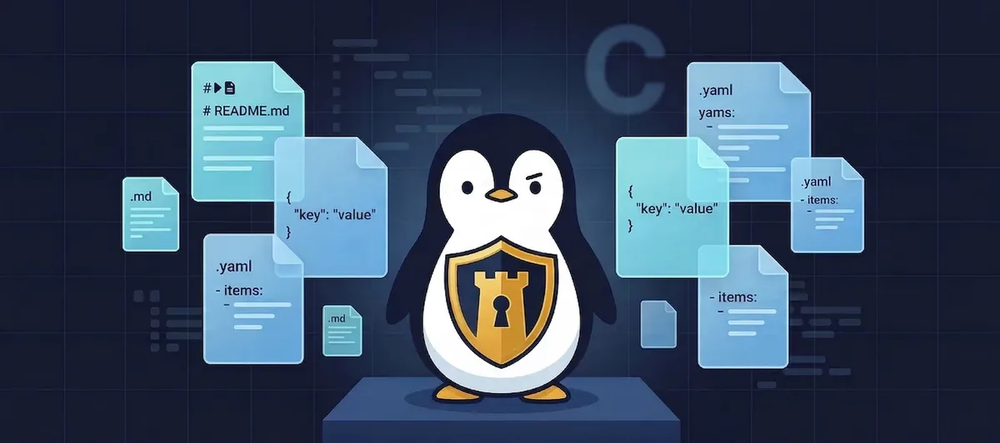

# prompt-shielder

<p align="center">
  
</p>

<p align="center">
  <strong>Integrity monitor for AI agent config files.</strong><br>
  Detects unauthorized modifications to behavior-defining files before your agent acts on them.
</p>

<p align="center">
  <a href="./LICENSE"></a>
  
  
</p>

---

## The Problem

AI agents don't just run code — their **behavior is defined by local files**. Claude Code reads `CLAUDE.md`. Codex reads `AGENTS.md`. Others use system prompts, `.env`, workflow manifests, or skill instructions.

If any of these files are silently modified, the agent is effectively hijacked. It will follow the tampered instructions without any visible signal to the user.

This is **prompt injection via config tampering** — and it's harder to detect than input-layer attacks because the poisoned instruction persists across sessions.

## The Solution

`prompt-shielder` uses SHA256 baseline tracking:

1. **Initialize** — record the known-good hash of each config file
2. **Verify** — compare current hashes against the baseline
3. **Alert** — any mismatch is immediately surfaced

```
================================================================
Integrity Check Summary
  Total:     5
  OK:        4
  Mismatch:  1
================================================================

INTEGRITY VIOLATION — 1 file(s) modified:
  - /home/user/project/CLAUDE.md

Recommended actions:
  1. Review the diff to understand what changed
  2. If intentional: run --update <filepath>
  3. If unintentional: treat as a security incident
```

## Quick Start

```bash
# Download
curl -O https://raw.githubusercontent.com/p3nchan/prompt-shielder/main/prompt-shielder.sh
chmod +x prompt-shielder.sh

# Create a config listing which files to monitor
cat > .prompt-shielder.json << 'EOF'
{
  "monitored_files": [
    "CLAUDE.md",
    ".env",
    "config.yaml"
  ]
}
EOF

# Initialize baseline
./prompt-shielder.sh --config .prompt-shielder.json --init

# Verify (run anytime, or put in cron)
./prompt-shielder.sh
```

## Commands

| Command | Description |
|---------|-------------|
| `verify` (default) | Verify all tracked files against baseline |
| `--init` | Create baseline from config watchlist |
| `--update <file>` | Refresh baseline for one file after intentional edit |
| `--add <file>` | Add a new file to monitoring |
| `--remove <file>` | Stop monitoring a file |
| `--list` | Show all tracked files and their status |
| `--config <file>` | Specify which config file to use (combinable with other commands) |

## Configuration

A JSON file with a `monitored_files` array:

```json
{
  "monitored_files": [
    "CLAUDE.md",
    ".env",
    "config.yaml",
    "system-prompt.md",
    "agents/worker-instructions.md"
  ]
}
```

Relative paths are resolved against `PROMPT_SHIELDER_ROOT` (defaults to current directory). State is stored in `.prompt-shielder/baseline.json`.

### Environment Variables

| Variable | Default | Description |
|----------|---------|-------------|
| `PROMPT_SHIELDER_ROOT` | `$(pwd)` | Project root to monitor |
| `INTEGRITY_ROOT` | — | Alias for `PROMPT_SHIELDER_ROOT` |

## Automate with Cron

```bash
# Check every hour
0 * * * * cd /path/to/project && ./prompt-shielder.sh >> /var/log/prompt-shielder.log 2>&1
```

Exit codes: `0` = all clear, `1` = violation detected, `2` = no baseline found.

## Why Not Just Git?

Git tracks changes, but:

- **Not all agent configs live in a git repo.** Many are in `~/.config/`, home directories, or deployed environments.
- **Git tracks *what* changed, not *when* or *who*.** prompt-shielder logs are timestamped for incident correlation.
- **Automation-friendly.** One command, machine-parseable exit code. Drop it in cron and pipe to your alerting system.

The two complement each other — prompt-shielder fills the "behavioral integrity monitoring" gap.

## Use Cases

- **Claude Code** — Monitor `CLAUDE.md`, project instructions, and `.env` files
- **OpenAI Codex CLI** — Watch `AGENTS.md` and workspace configs
- **Cursor** — Track `.cursorrules` and custom instructions
- **Any file-based agent** — System prompts, skill definitions, workflow manifests

## How It Works

- Computes SHA256 + file size at init, stores as JSON baseline
- On verify, recomputes and compares
- Cross-platform: `shasum -a 256` (macOS) / `sha256sum` (Linux), `stat -f%z` / `stat -c%s`
- JSON handling: `jq` when available, `python3` fallback
- Zero external dependencies beyond bash and a hash tool

## Background

This tool was extracted from [OpenClaw](https://github.com/nicepkg/openclaw)'s security practice. We run multiple AI agents (Claude Code, Codex CLI) whose behavior is defined by markdown and JSON config files. Config tampering is a real risk when agents have file-write access and process external input.

After running this integrity monitor in production for several months, we extracted and generalized it for any AI agent setup.

## Contributing

Issues and PRs welcome. Design principles:

- **Shell-first** — no compiled dependencies
- **Zero-dependency** — bash + shasum is all you need
- **Focused** — integrity monitoring, not full HIDS

## License

MIT. See [LICENSE](./LICENSE).
